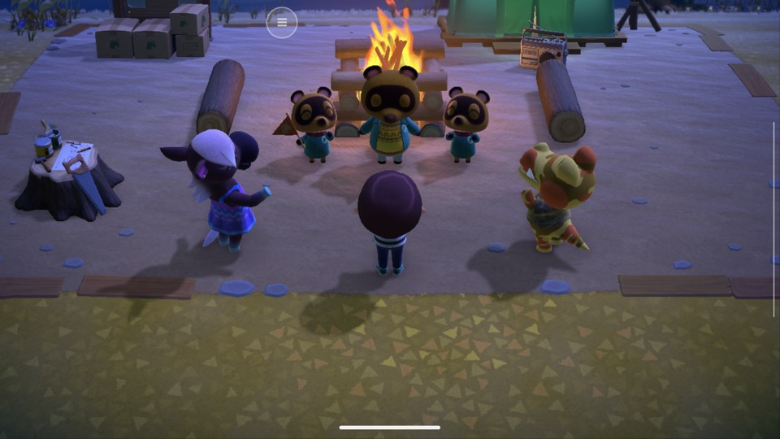
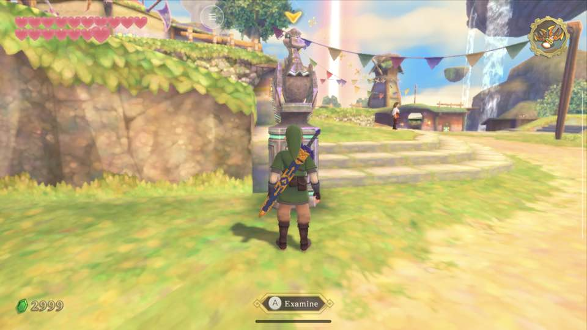
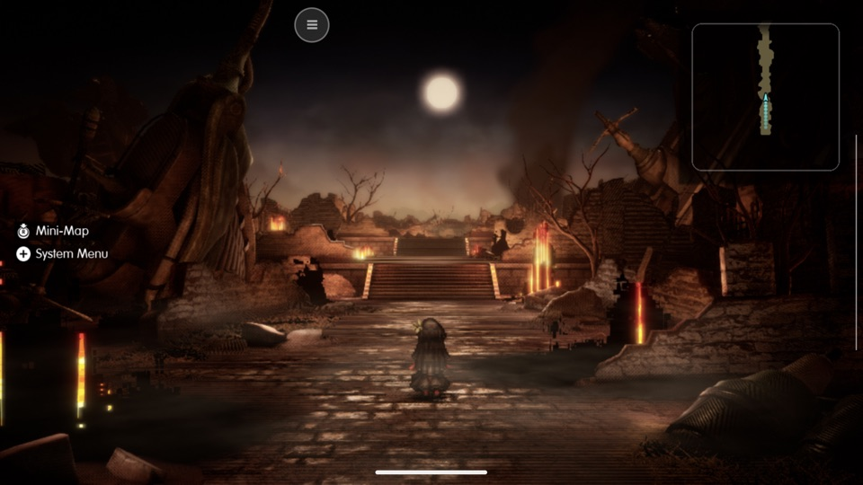
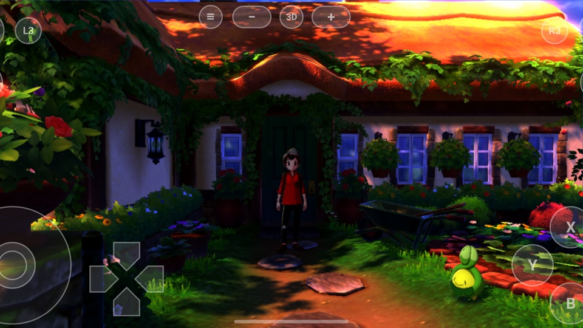
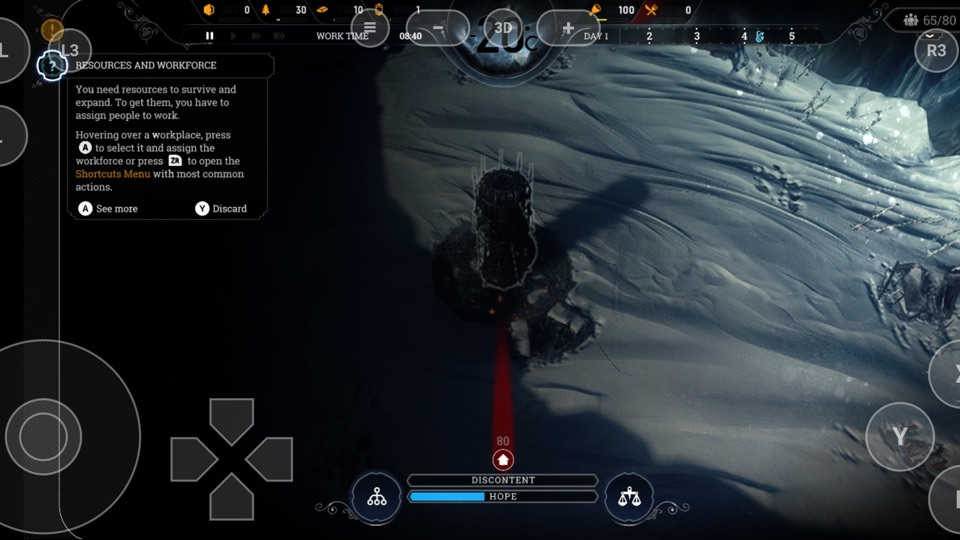
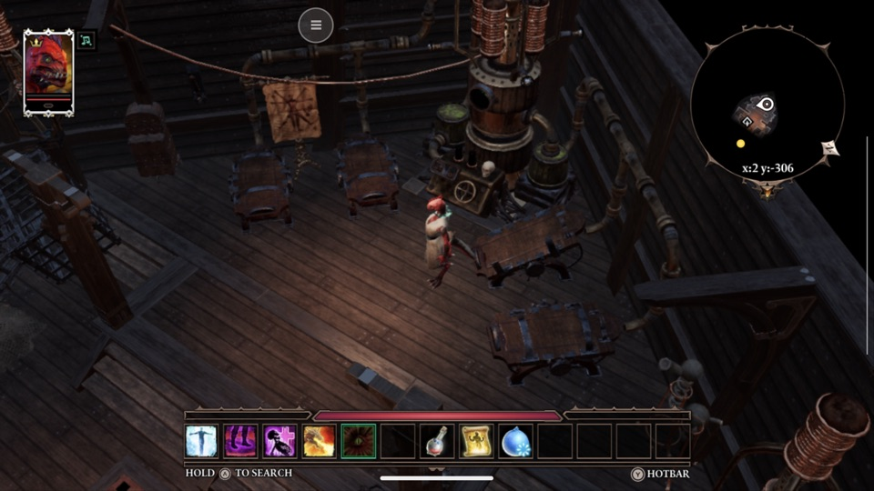
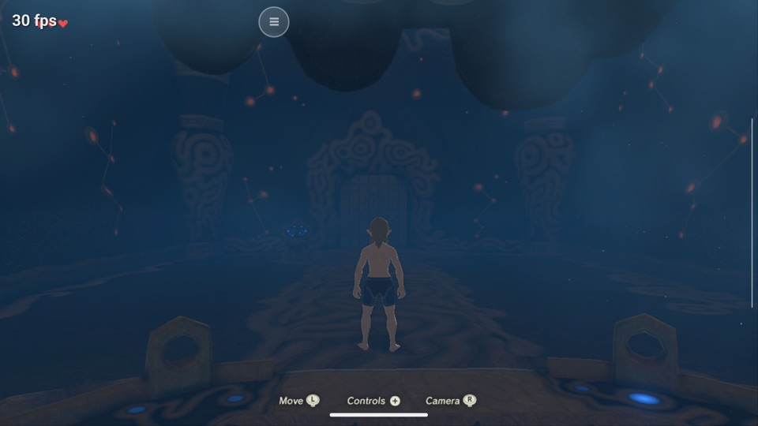
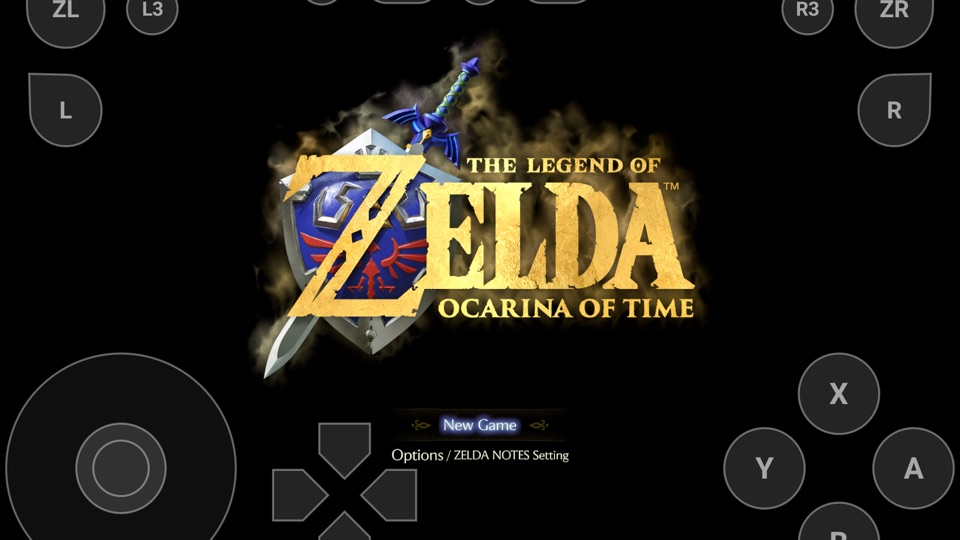
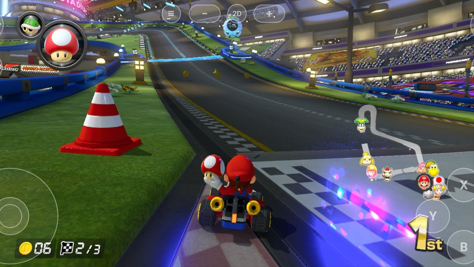

<!-- The "droidnative" anchor keeps links made before the rename working: the project was droidnative until 2026-11-09. -->
# <a id="droidnative"></a>DroidPlay Core

[](https://github.com/enjoyerofslop/droidplay-core/releases/latest)
[](LICENSE)
[](https://discord.gg/3r92f8wmh7)

**Play the Switch games you own on your Android phone or handheld, natively.** DroidPlay builds your own copy of a Switch game into an Android app: the
game's code runs directly on the phone's processor, not in an emulator, and its graphics are drawn by the phone's GPU through Vulkan.

It's for players with an Android phone or handheld and a Switch of their own to dump their games from. You build each game once on your computer, and
DroidPlay installs it on the phone. DroidPlay Core is the engine behind it: [seedds/nxnative](https://github.com/seedds/nxnative), which runs Switch games
natively on the iPhone, the iPad and the Mac, with an Android port that began as [RogelioLB/nxnative-android](https://github.com/RogelioLB/nxnative-android).

> [!IMPORTANT]
> **Bring your own game.** Nothing from any game is in this repository, and no packed game is distributed: you dump the game and the keys from **your own**
> Switch, and the app you build is for you only. Do not share APKs packed with a game (they carry its code and files), keys or firmware, and do not ask for them
> in issues. The project is not affiliated with Nintendo or any game publisher.

**Download [DroidPlay for Windows](https://github.com/enjoyerofslop/droidplay-core/releases/latest)**: **DroidPlay-Setup-&lt;version&gt;.exe** from the latest
release. Run it, and it walks you through the rest ([Get started](#get-started)). On a Mac, use [DroidPlay](https://github.com/enjoyerofslop/droidplay).

- **Runs on** arm64 phones and handhelds with Android 10 or later and a Vulkan GPU. Tested on Qualcomm Adreno (the Ayn Odin 2, the Retroid Pocket 5, the
  Galaxy S25 Edge and others), Arm Mali (the Pixel 9 Pro XL) and Samsung Xclipse (the Galaxy Z Flip 7): [Phones and handhelds](#phones-and-handhelds).
- **What plays:** [Game Status](#game-status) lists every game run on Android, on which devices, and how far it got.
- **Help:** the [DroidPlay Discord](https://discord.gg/3r92f8wmh7), #help for a problem and #compatibility for how a game runs on your device.

<table>
<tr>
<td align="center" valign="top" width="50%"><br><small><b>Get started</b>: your keys, the tools downloading, your phone and your first game</small></td>
<td align="center" valign="top" width="50%"><br><small><b>Library</b>: a game installed on the phone, ready to play</small></td>
</tr>
</table>

[Phones and handhelds](#phones-and-handhelds) · [Get started](#get-started) · [Updating](#updating) · [On your phone](#on-your-phone) ·
[Game Status](#game-status) · [Help and reports](#help-and-reports) · [Guides](#guides) · [How it works](#how-it-works) · [Contributing](#contributing)

## Phones and handhelds

DroidPlay runs on arm64 Android phones, handhelds and tablets with Android 10 or later and a GPU with Vulkan. How well a game runs depends on the GPU and the
game: [Game Status](#game-status) gives each game's frame rate on each device. Games have been run on these:

| Device | Chip | GPU |
|---|---|---|
| Samsung Galaxy Z Fold 8 | Snapdragon 8 Elite Gen 5 | Adreno 840 |
| Samsung Galaxy S25 Edge | Snapdragon 8 Elite for Galaxy | Adreno 830 |
| OnePlus Pad 3 | Snapdragon 8 Elite | Adreno 830 |
| Ayn Odin 2 | Snapdragon 8 Gen 2 | Adreno 740 |
| Moto Razr Plus 2023 | Snapdragon 8+ Gen 1 | Adreno 730 |
| Retroid Pocket 5 | Snapdragon 865 | Adreno 650 |
| POCO X5 5G | Snapdragon 695 | Adreno 619 |
| Google Pixel 9 Pro XL | Google Tensor G4 | Arm Mali-G715 |
| Samsung Galaxy Z Flip 7 | Samsung Exynos 2500 | Samsung Xclipse 950 |

Qualcomm's Adreno GPUs have had the most testing; Mali and Xclipse are newer to the project. The POCO X5 5G is the original port's device, last run before
2026-11-08. Other devices may work too, but haven't been tested by the project: say how a game runs on yours in #compatibility on the Discord.

### Another Vulkan driver (Turnip)

On an Adreno GPU, a game can run on a Vulkan driver you put on the phone instead of the system's, as in Switch emulators: usually a build of Mesa's
open-source Turnip driver. Trying one needs no new build, and whether it helps depends on the game and the device. The steps:
[Another Vulkan driver](docs/android.md#another-vulkan-driver-turnip).

## Get started

### What you need

- **A computer to build on:** a Windows 10 (1809 or later) or Windows 11 PC, 64-bit, for DroidPlay for Windows; or a Mac with Apple silicon and macOS 15 or
  later for [DroidPlay on a Mac](https://github.com/enjoyerofslop/droidplay). On Windows, DroidPlay and the tools it installs take about 6 GB, and each game's
  build needs room besides.
- **An Android phone or handheld** with Android 10 or later ([the devices tested](#phones-and-handhelds)), a USB cable (or wireless debugging), and room for
  the game: its files are copied to the phone (6.7 GB for Danganronpa V3).
- **Your own Switch, and the game and keys dumped from it:** the game as NSP or XCI files in one folder (the base game and, if you have them, its update and
  DLC; for example with nxdumptool), and your Switch's `prod.keys` (Lockpick_RCM). A Switch 2 game is built from its `.nup` file or dump folder, which needs
  no keys; Switch 2 games are at an early stage on Android ([Game Status](#game-status)).

### Install and build your first game

On Windows:

1. **Install DroidPlay.** Download **DroidPlay-Setup-&lt;version&gt;.exe** from the [latest release](https://github.com/enjoyerofslop/droidplay-core/releases/latest)
   and run it. Windows warns that it comes from the internet and isn't signed: choose **More info**, then **Run anyway**. It installs for your Windows user
   only, with no administrator prompt.
2. **Follow Get started.** DroidPlay opens on a checklist of four steps. Setting up takes about half an hour the first time.
   - **Your keys:** pick your `prod.keys`.
   - **Tools for building:** **Install tools** downloads the JDK, the .NET SDK and Google's Android SDK (about 1.5 GB to download). DroidPlay asks
     before accepting the Android SDK's license.
   - **Your phone:** turn on USB debugging, plug the phone in and tap **Allow** on it. **Set up my phone** shows the steps for your phone's brand.
   - **Your first game:** add the folder with its NSP or XCI files, then **Build and install**. The first build of a game takes about 10 to 20 minutes;
     later builds reuse what didn't change.
3. **Play.** Press **Play** in DroidPlay's Library, or open the DroidPlay app on the phone and pick the game. The first start of a game takes a minute or
   more while the phone prepares its shaders; later starts take a few seconds.

Every page of the app, uninstalling, and running it from source: [DroidPlay for Windows](docs/android.md#droidplay-for-windows).

### On a Mac or from the command line

- **On a Mac:** [DroidPlay](https://github.com/enjoyerofslop/droidplay) builds and installs Android games too: add your games folder, then **Install on
  Android** (one app holding every game, over adb) or **Build Game App**. Its README has the requirements and the setup steps.
- **From the command line,** on Windows, macOS or Linux: `scripts/build_android_from_nsp.py`
  ([Packing from the command line](docs/android.md#packing-from-the-command-line)).

## Updating

- **DroidPlay for Windows** says when a new release is out: press **Update**, or **Update to &lt;version&gt;** under Updates in **Settings**. It downloads
  the new Setup, checks it against the release, installs it and opens again; your games, builds and settings stay. Or close DroidPlay and run the new Setup
  yourself.
- **Games you've already built** keep what they were built with. Build them again (**Build and install**) to get a release's fixes; what didn't change isn't
  redone, so it's usually quick. Saves stay on the phone.
- **What changed** in each release is in the [release notes](https://github.com/enjoyerofslop/droidplay-core/releases).

## On your phone

- **The DroidPlay app** lists the games on the phone. Pick one for its settings (console mode, game language, render scale where the game supports it, the
  frame-rate counter, rumble), then **Play**.
- **Controls:** touch controls are drawn over the game in three layouts, 2D, 3D and Tap, switched with the round button at the top. A controller works as
  player 1 and hides them.
- **Back to the list:** the **≡** button at the top returns to the list while the game keeps running; **Play** on the same game resumes it.
- **Saves** stay in the app's storage, so updating the app keeps them. DroidPlay for Windows backs them up to your computer from its **Phones** page.
- **Game apps:** **Manage › Build a game app…** in DroidPlay for Windows makes one game into an app of its own, with its own icon and saves, to copy to a
  device and install there. It's for your own devices only: it carries the game, so never share it.

More: [The Android app](docs/android.md#the-android-app) · [Game apps](docs/android.md#game-apps).

<!-- The "status" anchor keeps links made before the rename working: DroidPlay's README links to #status. -->
## <a id="status"></a>Game Status

Which games run on Android, on which devices, and how far each has been played. Every row comes from runs on real devices, by the project or a contributor.
A Playable game was played by hand through the stretch its row names, with saves and sound checked; the tiers below say exactly what each label asks for.

Playable now:

- **Playable – minor issues:** Pokémon Brilliant Diamond, Pokémon Shield, Pokémon: Let's Go, Pikachu!, Persona 3 Portable and Divinity: Original Sin 2 - Definitive Edition.
- **Playable – major issues:** The Legend of Zelda: Breath of the Wild.

More games reach gameplay (In-game) or their menus; the table below has every game run on Android, and the issues seen.

Screen captures from the test runs, taken on the device. The round button at the top is DroidPlay's menu, the line at the bottom Android's gesture bar. On a
phone, DroidPlay's on-screen controls are drawn over the game.

<table>
<tr>
<td align="center" valign="top" width="33%"><br><small><b><a href="dm/games/0100000011D90000/README.md">Pokémon Brilliant Diamond</a></b><br>Ayn Odin 2: Eterna City, 60 fps</small></td>
<td align="center" valign="top" width="33%"><br><small><b><a href="dm/games/01006F8002326000/README.md">Animal Crossing: New Horizons</a></b><br>Ayn Odin 2: outside the player's house, 30 fps</small></td>
<td align="center" valign="top" width="33%"><br><small><b><a href="dm/games/0100000000010000/README.md">Super Mario Odyssey</a></b><br>Retroid Pocket 5: the opening cutscene, 59 fps</small></td>
</tr>
<tr>
<td align="center" valign="top" width="33%"><br><small><b><a href="dm/games/01006A800016E000/README.md">Super Smash Bros. Ultimate</a></b><br>Ayn Odin 2: a battle, 40–59 fps</small></td>
<td align="center" valign="top" width="33%"><br><small><b><a href="dm/games/01006BB00C6F0000/README.md">The Legend of Zelda: Link's Awakening</a></b><br>Ayn Odin 2: the Ancient Ruins, 60 fps</small></td>
<td align="center" valign="top" width="33%"><br><small><b><a href="dm/games/01002DA013484000/README.md">The Legend of Zelda: Skyward Sword HD</a></b><br>Ayn Odin 2: Skyloft at 60 fps</small></td>
</tr>
<tr>
<td align="center" valign="top" width="33%"><br><small><b><a href="dm/games/0100606026F12000/README.md">Final Fantasy Resonance</a></b><br>Ayn Odin 2: the first field, 42 fps</small></td>
<td align="center" valign="top" width="33%"><br><small><b><a href="dm/games/01008DB008C2C000/README.md">Pokémon Shield</a></b><br>Samsung Galaxy S25 Edge: outside the player's house in Postwick, 30 fps</small></td>
<td align="center" valign="top" width="33%"><br><small><b><a href="dm/games/0100B1C0249B4000/README.md">Frostpunk</a></b><br>Samsung Galaxy S25 Edge: the city, 30 fps</small></td>
</tr>
<tr>
<td align="center" valign="top" width="33%"><br><small><b><a href="dm/games/010027400CDC6000/README.md">Divinity: Original Sin 2 - Definitive Edition</a></b><br>Ayn Odin 2: the Merryweather's hold, 30 fps</small></td>
<td align="center" valign="top" width="33%"><br><small><b><a href="dm/games/01007EF00011E000/README.md">The Legend of Zelda: Breath of the Wild</a></b><br>Ayn Odin 2: the Shrine of Resurrection, 30 fps</small></td>
<td align="center" valign="top" width="33%"><br><small><b><a href="dm/games/0400C3F00006E000/README.md">Mario Kart World</a></b><br>Ayn Odin 2: the world map, about 55 fps</small></td>
</tr>
<tr>
<td align="center" valign="top" width="33%"><br><small><b><a href="dm/games/0400486024DEC000/README.md">The Legend of Zelda: Ocarina of Time</a></b><br>Samsung Galaxy Z Fold 8: the title, about 30 fps</small></td>
<td align="center" valign="top" width="33%"><br><small><b><a href="dm/games/0100152000022000/README.md">Mario Kart 8 Deluxe</a></b><br>Google Pixel 9 Pro XL: Mario Kart Stadium, 60 fps</small></td>
<td></td>
</tr>
</table>

Each row's State starts with its tier: the highest one whose conditions have all been shown. Both Playable tiers say how far the game was played ("through …");
neither means the whole game was.

| Tier | What has been shown |
|---|---|
| **Playable – minor issues** through *a named stretch* | Everything Playable – major issues asks, and on at least one device, through the stretch: a median frame rate of at least 95% of the target, with no 30 s window under 90% of it (loads, scene changes and a first start's shader and pipeline builds excepted); only cosmetic faults (a one-frame artefact, a slightly wrong colour or shade, draws left out only while a first start builds its pipelines), each one compared with the Mac; no crash or hang; sound right; Continue loading the latest save; and a stretch that takes in the game's first battle, race or level end |
| **Playable – major issues** through *a named stretch* | Played by hand (adb input counts; a scripted run alone doesn't) from a new game or a save made on Android, through the stretch named (a save made by hand on another Android device counts; a save made on the Mac doesn't); at least half the target frame rate (a median); the stretch finished, with at most one crash or hang, got past with a restart and Continue, and not back at the same point; a save made on Android and loaded again after a cold start; sound checked. The row names each issue that keeps it from Playable – minor issues |
| **In-game** | Gameplay under the player's control, not only menus or movies, with the picture usable and at least half the target frame rate, but not yet shown playable: a scripted run, someone else's save or a save made on the Mac, no stretch played by hand, or saves or sound not checked |
| **In-game, blocked** | Gameplay reached, but a named bug stops normal play: the world missing or black, under half the target frame rate, or a crash or hang that comes back at the same point |
| **Menus** | The title, menus or movies; no control of the player in gameplay |
| **Boots** | A first frame or a logo; nothing further shown |
| **Doesn't run** | Stops before its first frame, or the packing script refuses it |

The target frame rate is the rate the game runs at by default on Android: `DM_FPS_TARGET` in its profile's `android_defaults.txt`, else the profile's
`fps_target`, else the Switch's rate. A row's tier rests on the device that has shown the most, and the row says how the others did.

The rest of each row says on which devices, how far and how (by hand, or a scripted run from a fresh or a downloaded save), the frame rate, the issues seen,
and what has not been tried.

| Game | Device | State |
|---|---|---|
| Pokémon Brilliant Diamond 1.3.0 | Ayn Odin 2, OnePlus Pad 3, Retroid Pocket 5, Samsung Galaxy S25 Edge, Samsung Galaxy Z Flip 7, Google Pixel 9 Pro XL, Moto Razr Plus 2023 | Playable – minor issues through Lake Verity's first battle: 60 fps (the profile's rate; the Switch runs it at 30). On the Pixel 9 Pro XL (Mali), the Moto Razr Plus 2023 (Adreno 730) and the Samsung Galaxy Z Flip 7 (Xclipse), played by hand from a new game through Twinleaf, Route 201 and Lake Verity to Turtwig and the first battle, a wild Starly, won, with sound, a save made on the phone and Continue working; on the Z Flip 7, 59.8 fps over 32 minutes (no 30 s window under 57.9) and Twinleaf's pond drawn as water since #204. Issues: on the Pixel, one minute at the starter screen at 50–54 fps; none seen on the Razr or the Z Flip 7. On the other four, In-game: 59–60 fps in Eterna City's overworld, in a scripted run from a downloaded save with the player standing by the Pokémon Center; a new game was played by hand into the overworld on the Odin 2 on 2026-11-07, before the nxnative merge, and not since. The Retroid Pocket 5 no longer crashes at launch, and its own driver now runs Eterna City as fast as [Turnip](#another-vulkan-driver-turnip) does (15 fps before) |
| Animal Crossing: New Horizons 3.0.3 | Ayn Odin 2, OnePlus Pad 3, Retroid Pocket 5, Samsung Galaxy S25 Edge | In-game: 30 fps (as on the Switch) on all four, in scripted runs: the new game's airport at Nook Inc.'s counter (a fresh save, no input), and outside the player's house from a downloaded save with the player standing. On the Odin 2, played by hand from a new game through character creation, the flight and the arrival, Tom Nook's welcome and the tents to the first evening's request for branches, at 30 fps with sound. The game saves only after the first night, which was not reached, so a save made on Android and Continue are not checked yet: Playable waits for a person to play on to the first night |
| Super Mario Odyssey 1.4.1 | Ayn Odin 2, OnePlus Pad 3, Retroid Pocket 5, Samsung Galaxy S25 Edge, Google Pixel 9 Pro XL | In-game: the Start menu and the opening cutscene at 59–60 fps on all five (the cutscene ran at 38 on the Retroid Pocket 5 on 2026-11-08), and play in the Cap Kingdom at 60 on the Odin 2 (one scripted run of 15 s), past the hint video that used to crash it (the host's AVC decoder, fixed; the video plays on the Pad 3 too). Not played by hand. The crash now and then while it loads is fixed. The Pixel 9 Pro XL's Mali-G715, the first GPU outside Adreno, has no BC textures, so they are decoded on the CPU (2.2 GB resident in the cutscene, against 1.64 GB) |
| Super Smash Bros. Ultimate 13.0.5 | Ayn Odin 2, OnePlus Pad 3, Retroid Pocket 5, Samsung Galaxy S25 Edge | In-game: boots to its opening movie at 60 fps on all four, with the hinted shared font the packer now ships (Android's Roboto made it crash); the crash in about one boot in five is fixed too. The route's battle (Mario against a random CPU fighter, the player idle; not played by hand) runs at 60 fps on the S25 Edge, 52–60 on the Pad 3 (2026-11-09) and 57–60 on the Retroid Pocket 5 (2026-11-10), by stage and fighter; 40–59 on the Odin 2 (2026-11-08, not measured since) |
| The Legend of Zelda: Link's Awakening 1.1.0 | Ayn Odin 2, OnePlus Pad 3, Retroid Pocket 5, Samsung Galaxy S25 Edge | In-game: from a downloaded save at the Ancient Ruins (after the fifth dungeon), Link standing, the picture right: 60 fps on the Odin 2, 38–45 on the S25 Edge, and 32–33 on the Pad 3 and the Retroid Pocket 5, where the game drops to its 30 fps interval. Not played by hand or from a new game. The boot crash it had on every launch on the Retroid Pocket 5 and now and then on the Pad 3 is fixed (checked on the Retroid Pocket 5) |
| The Legend of Zelda: Skyward Sword HD 1.0.1 | Ayn Odin 2, OnePlus Pad 3, Retroid Pocket 5, Samsung Galaxy S25 Edge | In-game: Skyloft's plaza from a downloaded 31-hour Hero Mode save, Link standing at the bird statue, its terrain in colour on all four: 59–60 fps on the Odin 2, the Pad 3 and the S25 Edge, and 43 on the Retroid Pocket 5, where the game switches between its 60 and 30 fps intervals within a run. The opening movie at 55–60 fps (41 on the Retroid Pocket 5). Not played by hand or from a new game on Android |
| Final Fantasy Resonance 1.0.1 | Ayn Odin 2, OnePlus Pad 3, Samsung Galaxy S25 Edge, Google Pixel 9 Pro XL | In-game: a new game's opening into the first field in a scripted run, then Continue from its autosave and a walk north: about 42 fps on the Odin 2 and the Pad 3 and 30–33 on the S25 Edge, with the field drawn right (10–16 fps before 0.6.0; the Odin 2 drew its flames from `ANDROID_CHAIN` 6); the opening at 30 fps on the Pixel 9 Pro XL. Not played by hand or past the first field, no battle yet; not tried on the Retroid Pocket 5 |
| Pokémon Shield 1.3.2 | Retroid Pocket 5, Samsung Galaxy S25 Edge, Google Pixel 9 Pro XL, Samsung Galaxy Z Flip 7 | Playable – minor issues through Route 2 into Professor Magnolia's house: 30 fps (as on the Switch) on all four. On the Z Flip 7 (Xclipse), played by hand from a new game through the opening, Route 1, Wedgehurst and the starters to Hop's battle, won, then into the Slumbering Weald with a wild battle there; on the Retroid Pocket 5, as far as Hop's battle, won, and from the Z Flip 7's Weald save through the Weald's event (the battle in the fog, Leon's rescue) back to Postwick and Mum, then from there through Wedgehurst (the Pokédex), Route 2 and its first trainers into Professor Magnolia's house; on the S25 Edge and the Pixel 9 Pro XL (Mali), into Postwick, where Hop meets the player outside the house. Sound, saves made on the phone and Continue work on all four. Issues: a first start's pipeline builds (one 6.4 s frame on the Z Flip 7 and one of 5.0 s on the Retroid Pocket 5; 118 and 178 ms at most on the next start), and frames of 1.4–1.7 s as the lab and Route 2 built theirs on a first visit; nothing else seen. Not played as far as the battle in Magnolia's garden or the Wild Area; not tried on the other devices |
| Frostpunk 1.0.1 | Samsung Galaxy S25 Edge, Moto Razr Plus 2023 | In-game: 30 fps from the title through A New Home's intro into the city, with sound, in scripted runs and about two minutes with live input. The Generator, the buildings and the props draw through raw global memory, which its profile turns on. Not played past the first minutes: no building placed, no night, no save made. On the Moto Razr Plus 2023 (Adreno 730, Qualcomm's driver V@0615.98), In-game, blocked: the title, the menu, the intro and the city at 29 fps with sound, but the driver's compiler refuses every pipeline of the shaders that read raw global memory (`OpConvertUToPtr not supported`), so the Generator, the buildings and the props stay invisible |
| Pokémon: Let's Go, Pikachu! 1.0.0 | Samsung Galaxy Z Fold 8, Google Pixel 9 Pro XL, Samsung Galaxy Z Flip 7 | Playable – minor issues through Viridian City and the rival's first battle (Oak's Parcel): 30 fps (as on the Switch) on all three. On the Z Fold 8, played by hand from a save made on the phone in Pallet Town through Professor Oak's scene, getting Pikachu, his lab and the Pokédex, to two wild catches on Route 1 made with the buttons (no motion needed); the opening into Pallet Town was a scripted run there. On the Pixel 9 Pro XL (Mali), played by hand from a new game through the opening and the rival's visit into Pallet Town, and a wild Pidgey caught on Route 1 from the Z Fold 8's save. Then, from that save, by hand through Route 1 (more catches) to Viridian City, the Poké Mart clerk's Oak's Parcel back to Professor Oak, and the rival's first battle in the lab (his Eevee, won with Thunder Shock), at 29.6–30.0 fps in every minute of a 35-minute launch, with a save made after it that Continue loads after a cold start. On the Z Flip 7 (Xclipse), played by hand from a new game through the opening into the bedroom, then from the Pixel's save after the battle through Route 1 (a trainer battle won), Viridian City and Route 2 into Viridian Forest, with a save there that Continue loads after a cold start. Sound (confirmed by audio dumps), a save made on the phone and Continue work on all three. Issues: none seen up to the rival's battle. On the Z Flip 7, the walk past Viridian Forest's first Bug Catcher ran at 21–28 fps for 40–90 s each time (the game's own frame work; not compared with the Mac), which keeps the forest out of the minor-issues stretch. Not tried: the Pokémon Center and Mart inside, Viridian Forest's trainers and Pewter City, aiming with motion, the other devices |
| Divinity: Original Sin 2 - Definitive Edition 1.0.3.1 | Ayn Odin 2, OnePlus Pad 3, Google Pixel 9 Pro XL | Playable – minor issues through the second fight below deck (before the locked Greasy Door): the game's 30 fps from a new game through character creation and the opening cinematic into the Merryweather's hold, then by hand to the cabin deck, and on the Odin 2 through the burning hold to the top deck's first fight (two Voidwoken, won), the lifeboat and its dialogue, and below deck a second fight (Void Hatchlings, won with Lohse and Beast), with sound, Quick Saves dated by the host's clock and Continue loading the latest after a cold start. Every window's median frame time 33.1–33.5 ms; four alpha-test red lines in the log, nothing wrong on screen. On the Pixel 9 Pro XL (Mali) the top deck's first fight, won, at 30 fps too, with sound and Continue after a cold start; its GPU takes about 26 ms of the 33 ms frame ([its note](dm/games/010027400CDC6000/README.md#on-the-pixel-9-pro-xl)). On the Pad 3 it runs at 40 or 60 fps with a setting, the game moving by real time at each, and held 60 for 25 minutes ([its note](dm/games/010027400CDC6000/README.md#frame-rate)). Not played as far as Fort Joy |
| The Legend of Zelda: Breath of the Wild 1.9.0 | Ayn Odin 2, OnePlus Pad 3, Samsung Galaxy S25 Edge, Samsung Galaxy Z Fold 8 | Playable – major issues through the Shrine of Resurrection onto the Great Plateau (no combat yet): 30 fps (its Android target) on the Odin 2, played by hand from a new game: waking in the Shrine, taking the Sheikah Slate, opening its doors and climbing out, then the cutscene over Hyrule and the first minutes on the plateau, with sound, an autosave made on the phone and Continue after a cold start. The Old Man not reached ([its note](dm/games/01007EF00011E000/README.md#android)). Issues: the stretch ends before the first combat; the frame where Link died from a fall had red smears on nearby rocks, not compared with the Mac. The Shrine from a save made on the Mac: 30 fps on the Pad 3 and the S25 Edge with its Android defaults (descriptor sets bound again, the command recorder, a 30 fps target); 24 on the Galaxy Z Fold 8, whose GPU takes 30 ms a frame. On the Pad 3 it lost the GPU at its first frame in the field, and on both Adreno 830s it drew the Shrine dark: both are fixed, checked on the S25 Edge and, by hand from a new game with main's 0.7.5 build, on the Pad 3: the Shrine lit, about 5.5 minutes on the plateau without losing the GPU at 30 fps, and a save loaded by Continue after a cold start. 60 fps needs the replay's CPU time and the GPU's to come down |
| Persona 3 Portable 1.0.2 | Samsung Galaxy S25 Edge, Samsung Galaxy Z Flip 7 | Playable – minor issues through the first battle (April 9's rooftop): 60 fps (as on the Switch) on both, played by hand from a new game through the opening, the dorm and the first school days with their point-and-click exploration, to the night of April 9 and its first battle, won with the buttons, with sound, a save made at the dorm's Sign-In Sheet and Continue working. On the S25 Edge in console mode, on the Z Flip 7 (Xclipse) in Android's default handheld mode, which works on both ([its note](dm/games/0100DCD01525A000/README.md#android)). Issues: none seen on the S25 Edge; on the Z Flip 7, one frame of the opening movie covered in a fine dot grid, not compared with the Mac. Not played past the first battle (Tartarus); not tried on the other devices |
| Mario Kart 8 Deluxe 4.0.1 | Google Pixel 9 Pro XL, Moto Razr Plus 2023 | In-game: two 50cc Grand Prix races at Mario Kart Stadium (the Mushroom Cup), both won, at 60 fps (as on the Switch), from a new save: boot, the title's demo race, the Mii pick (the heads blank, as on the Mac), the menus with their movie previews, then the race; the save loads after a cold start, with sound. The steering was the game's Smart Steering, with accelerate held over adb, so Playable waits for a race steered by hand with a controller. The Mali GPU has no BC textures, so they are decoded on the CPU: 4.3 GB resident against the Mac's 2.4. On the Moto Razr Plus 2023 (Adreno 730) the title and menus run at 60 fps in 1.9 GB, but every course load, the demo race's or a race's, crashes in Adreno's driver as a render pass ends ([its note](dm/games/0100152000022000/README.md#android)) |
| SHIN MEGAMI TENSEI V: Vengeance 1.0.3 | Samsung Galaxy S25 Ultra | In-game (contributor report): a save in Mita at 30 fps, and at 60 with `DM_UE_DYNRES_BUDGET=16.7` ([its note](dm/games/010069C01AB82000/README.md#frame-rate)). Not run on the project's devices |
| Super Mario Bros. Wonder 1.2.1 | POCO X5 5G (Adreno 619) | In-game: about 30 fps of the game's 60 at render scale 0.8, in levels and on the world map; below 60 fps Piranha Plants on Parade softlocks unless the stopgap `DM_AUDIO_PACE=game` is on ([audio](docs/reference/audio.md#music-timed-sequences-on-a-device-below-the-games-frame-rate)) † |
| Super Mario 3D World + Bowser's Fury 1.2.2 | POCO X5 5G | Menus: Bowser's Fury starts and is drawn with correct colours; how far it was played isn't recorded, and one launch stopped at a black loading screen † |
| Danganronpa V3 Anniversary Edition 1.0.2 | POCO X5 5G | Menus: boots, plays its opening movie and draws its picture, from a provisional profile; not played through † |
| The Binding of Isaac: Afterbirth+ 1.7.9b | POCO X5 5G | Boots: runs from a provisional profile with its Repentance DLC, its shaders compiled at run time and captured on the phone; how far it got isn't recorded † |
| **Mario Kart World 1.8.0 (Switch 2)** | Ayn Odin 2 | **Menus** (2026-11-08, not run since): the world map at about 55 fps, then the attract drive at about 3.4 fps, with no input given. Open: sparse textures (the terrain is untextured), virtual memory pools, constant-buffer copies in the replay, no mesh shaders on the device |
| **The Legend of Zelda: Ocarina of Time v131072 (Switch 2)** | Samsung Galaxy Z Fold 8 | **In-game, blocked:** the title at about 30 fps (the movie behind the logo black), the Load screen, and Kokiri Forest from a Mac save at about 1.7 fps with the forest black: 2,247 of the game's shaders read raw global memory, which the Vulkan replay doesn't have yet. Open: raw global memory, then the CPU's 460 ms a frame and the memory (10.2 GB of the phone's 11.3) |

† Tested before DroidPlay Core merged nxnative's `main` (2026-11-08); not run since. "Not run since" with a date marks a later run on code `main` has moved on
from, and "contributor report" a run on a contributor's own device.

The rows for the first six games, Final Fantasy Resonance and Breath of the Wild are from the [Android baselines](dm/android/baselines.md): the same scripted runs on
each device, with frame times, the devices' drivers, and the known problems with what is known of their causes. The first were measured on 2026-11-08 on the Odin
2, the Pad 3 and the Retroid Pocket 5. On 2026-11-10 the Galaxy S25 Edge's column and the rows for Final Fantasy Resonance and Breath of the Wild were added, and
the Retroid Pocket 5's rows were measured again; Ocarina of Time on the Galaxy Z Fold 8 and Super Mario Odyssey on the Pixel 9 Pro XL have sections of their own
there; cells measured again since are dated (Smash's battles, Link's Awakening's Ancient Ruins, Skyward Sword HD's Skyloft). The other rows are
from the games' own notes, which the [games table](dm/games/README.md#games) links, but for three: SHIN MEGAMI TENSEI V: Vengeance's device is named in its
contributor's pull request ([#101](https://github.com/enjoyerofslop/droidplay-core/pull/101)), Mario Kart World's run of 2026-11-08 is not in its note yet, and
the POCO X5 5G rows are from the original port's README.

Every other game in the [games table](dm/games/README.md#games) has a profile and can be packed the same way, but has not been run on Android. A game without a
profile can still be packed as an *experimental build*: most likely it does not boot, but it is the starting point for porting it.

The Android host replays NVN only. A game that draws with OpenGL or makes its own Vulkan calls (OpenGL or Vulkan in the games table's Graphics column) cannot
draw on Android, since the OpenGL and Vulkan layers are the Mac's, on Metal: Balatro, Digimon Story Cyber Sleuth, Street Fighter 30th Anniversary Collection and
Well Dweller (OpenGL), and Hades and both Super Mario Galaxy games (Vulkan). The packing script stops on such a game and says why, before the rewrite and the
shaders. Super Mario 3D All-Stars still builds, since its launcher draws with NVN, but Super Mario 64 and Sunshine inside it call Vulkan and cannot draw.
The games the script refuses are in the Doesn't run tier. Street Fighter 30th Anniversary Collection stopped at its first EGL call on a Retroid Pocket 5
before the script refused it ([its note](dm/games/0100024008310000/README.md#android)).

## Help and reports

- **Ask in the [DroidPlay Discord](https://discord.gg/3r92f8wmh7):** #help for a problem, #compatibility for how a game runs on your device. Its rules are
  this README's: no games, keys, firmware or packed APKs.
- **When a build fails,** DroidPlay for Windows says why in plain words, with the button that fixes it where there is one. Otherwise **Copy report** on the
  Builds page copies a short report to paste in #help; it leaves out your user folder, the phone's serial and anything that looks like a key.
- **A useful report** names the device and its GPU (Settings, or `adb shell getprop ro.product.model`), Android version, the game, its title ID and version,
  how it was packed (DroidPlay, the command line, game app or launcher), and attaches the log: `adb logcat -s DroidPlay` (`-s nxnative` for an app older
  than 0.5.0), or `log.txt` in the app's folder (`Android/data/<package>/files/`). A screenshot and the first `[RED]` lines help most. Never attach game
  files or keys.
- **Testers and contributors** can also open an issue with the bug report form ([Reporting a problem](CONTRIBUTING.md#reporting-a-problem)).

## Guides

- [DroidPlay for Windows](docs/android.md#droidplay-for-windows): installing, Get started and every page of the app, in detail.
- [The Android app](docs/android.md#the-android-app): the launcher, a game's settings, the first start, controls, saves and the log.
- [Game apps](docs/android.md#game-apps): a game as an app of its own.
- [Another Vulkan driver (Turnip)](docs/android.md#another-vulkan-driver-turnip): on an Adreno GPU, a driver you put on the phone.
- [Games that compile their shaders while they run](docs/android.md#games-that-compile-their-shaders-while-they-run): The Binding of Isaac, for one.
- [Packing from the command line](docs/android.md#packing-from-the-command-line): what it needs, and its options.
- [Seeing what a game draws](docs/android.md#seeing-what-a-game-draws): screenshots, frame dumps and thread states from a running game.

## How it works

A Switch and an Android phone both run ARM64 code, so there is no CPU emulation. The game's code is rewritten only where the host needs it (system calls,
thread registers), a host answers the Switch's system calls and SDK services, and the game's NVN graphics are replayed on the GPU through Vulkan, with its
shaders translated to SPIR-V when the game is built.

### How it fits together

```
 Your computer (Windows, macOS or Linux)                         Your Android phone
 ───────────────────────────────────────                         ─────────────────────────────────────
 NSP / XCI files + prod.keys                                     DroidPlay app (org.nxnative.android)
          │                                                        ├─ Launcher: the games on the phone,
          ▼                                                        │    each game's settings, Play
 Desktop app: scripts/nxnative_android.py                          │
 (or the command line: scripts/build_android_from_nsp.py)          └─ Game screen, in its own process:
          │  1. extract the game (nx_extract)                           loads that game's host
          │  2. rewrite its code for Android (patch_nso.py)             (libdmhost_<title ID>.so), which runs
          │  3. split its shaders, translate them to SPIR-V             the game's code and replays its
          │  4. build the game's host with the Android NDK              graphics on Vulkan
          │  5. pack one APK carrying every game built so far
          └─ adb: install the APK, copy the game files ──────▶   Android/data/org.nxnative.android/files/games/<title ID>/
```

One app holds every game: each game you build adds its host to a library on your computer, and every APK is packed from the whole library, so building a second
game keeps the first one in the app. Game files (code, shaders, RomFS, icon) live in the app's folder on the phone; saves stay in the app's internal storage.

### What the Android port changed

The iOS / Mac host runs on Android with stand-ins for the Darwin interfaces it calls (`dm/android/compat`); the guest's thread slots go through the x18 register (the
rewriter emits `mov xN, x18` for `DM_TARGET=android`). NVN is replayed on Vulkan (`dm/android/gfx_vk.c`, `gfx_vk_draw.inc`): textures (BC decoded on the CPU where the
GPU lacks it), copies, clears, draws, compute, indirect draws, transform feedback, queries and timestamps, submitted in chunks so the GPU works while the CPU records;
shaders are translated with the project's translator and adjusted for Android drivers (`dm/android/tools/spv_android.py`). Audio goes through AAudio, movies through
MediaCodec. Details of the port: [dm/android/README.md](dm/android/README.md).

Problems found on the way, each with its cause and fix in the reference ([rendering](docs/reference/rendering.md#android-vulkan-replay), [memory](docs/reference/memory.md),
[NVN objects](docs/reference/nvn-objects.md)):

- **Wrong pictures:** the Adreno driver misreading dynamic vector components in uniform buffers (vertical stripes); render targets attached in their sRGB view format
  (washed-out colours); `char` unsigned on Android (noise in clouds); separate textures read as "no texture" because the texture and sampler banks are packed into one
  field (Danganronpa V3's black screen); a second NVN device resetting the window origin (an upside-down picture); a 3D colour-grading LUT drawn a slice at a time into
  one slice (Bowser's Fury's blue scene).
- **Crashes:** the thread stack reported with bionic's guard page, which Unity's garbage collector scanned (Danganronpa V3 at boot); `pthread_exit` run on a game
  thread's small stack (Bowser's Fury after a few seconds).
- **Speed:** syncs limited to what a draw reads, passes kept open, early and mid-pass submissions, constant buffers copied only as far as the shader reads, pipeline keys
  built from the state fields, a capped pipeline prebuild; *Game time* holds the audio to the game's frames for levels timed to the music.

## Contributing

DroidPlay Core is nxnative with an Android port. Android work belongs here; a fix for the Mac or the iPhone goes to
[seedds/nxnative](https://github.com/seedds/nxnative) first and reaches DroidPlay Core with the next merge. nxnative's `main` is merged in regularly, so
its games, fixes and Switch 2 work reach Android too; nxnative itself stays Apple-only by its maintainer's choice. Testers and contributors are welcome.

- [CONTRIBUTING.md](CONTRIBUTING.md#droidplay-core): how a change gets in, the checks to run, and how DroidPlay Core stays in step with nxnative.
- [dm/android/README.md](dm/android/README.md): the Android host, the Vulkan replay, packing, game apps and the desktop app.
- [Android baselines](dm/android/baselines.md): the same scripted runs on each device, with frame times, the drivers and the known problems.
- [The games table](dm/games/README.md#games) and each game's note: what its profile needs, what was found on it and what is open.
- [AGENTS.md](AGENTS.md) and [docs/agents](docs/agents/README.md): where to start on a crash, a hang or a wrong picture.
- [docs/development.md](docs/development.md): nxnative's internals, the packing script's options and building by hand.

## Credits and license

- [seedds/nxnative](https://github.com/seedds/nxnative) runs Switch games natively on the iPhone, the iPad and the Mac; DroidPlay Core is nxnative with an
  Android port. nxnative's [acknowledgements](#acknowledgements), below, name the work both stand on.
- [RogelioLB/nxnative-android](https://github.com/RogelioLB/nxnative-android) began the port: the Vulkan replay of NVN, the Android front end and the packing
  script.
- DroidPlay Core was called droidnative until 2026-11-09, and was renamed so as not to be confused with
  [DroidNative](https://github.com/DroidNative/DroidNativeApp), which runs Linux desktop apps on Android
  ([#40](https://github.com/enjoyerofslop/droidplay-core/issues/40)). Links to the old name lead here.
- MIT ([LICENSE](LICENSE)). Third-party code keeps its own license ([dm/third_party](dm/third_party/README.md)).

Below the line is nxnative's own README, merged in from nxnative with the rest of its changes: building games for the iPhone, the iPad and the Mac.

---

# nxnative

Play your own Nintendo Switch and Switch 2 games natively on Apple silicon Macs, iPhone and iPad. One script packs your game into a Mac app or an unsigned IPA that you sideload.

It is not an emulator: the game's own code runs directly on the Apple chip, with Switch graphics rebuilt on Metal. Nothing from any game is in this repository, and the project is not affiliated with Nintendo or any game publisher.

[Games](#games) · [Community front ends](#community-front-ends) · [Requirements](#requirements) · [How to play](#how-to-play) · [Discussions](#discussions) · [For developers](#for-developers)

## Games

The full [tested games table](dm/games/README.md#games) includes original Switch games, tested builds, engines and graphics APIs. Each game's note records its tested platforms, progress and known issues.

These Switch 2 games have passed Mac gameplay testing. Build them from a [`.nup` file or a dump folder](#switch-2-games):

- [Donkey Kong Bananza](dm/games/040074A01BF12000/README.md)
- [Fire Emblem Fortune's Weave](dm/games/04007EF01F8AE000/README.md) — up to 120 fps
- [Hyrule Warriors: Age of Imprisonment](dm/games/04003F40232DE000/README.md)
- [Kirby Air Riders](dm/games/040077201BE50000/README.md)
- [Mario Kart World](dm/games/0400C3F00006E000/README.md)
- [Mario Tennis Fever](dm/games/0400D4201C6EA000/README.md)
- [Pokémon Pokopia](dm/games/0400A3A01EE4C000/README.md)
- [Splatoon Raiders](dm/games/0400380020056000/README.md)
- [Star Fox](dm/games/0400E88025B1A000/README.md)
- [The Legend of Zelda: Ocarina of Time](dm/games/0400486024DEC000/README.md)
- [Yoshi and the Mysterious Book](dm/games/0400245021D2C000/README.md)

## Community front ends

Community projects build on nxnative with tools to turn your games into apps for your iPhone, iPad or Mac without the command line, and libraries to organize and launch them. They are separate projects: questions and bugs about them go to their own pages.

- [NX2Apple](https://github.com/LNPANDY/NX2Apple) — Mac builder with a shared iPhone/iPad game library.
- [NX Play](https://github.com/varyform/nx-native-wrapper) — Mac library with device installs and save sync.
- [NxNative Launcher](https://github.com/rennan101/nxnative_Launcher) — Mac launcher with guided builds and controller mapping.
- [LumaNX](https://github.com/Xc1Ym/LumaNX) — Mac game builder with IPA export.
- [GameCase](https://github.com/Tiaoge-tou/GameCase) — iOS game library based on LiveContainer.

## Requirements

- **Mac:** Apple silicon, macOS 26.6 or later. Building games requires Xcode 27.2.
- **iPhone:** A17 Pro chip or later, with iOS 26 or later.
- **iPad:** M1 chip or later, with iPadOS 26 or later.

The games' textures are BC-compressed, which older iPhones cannot read. Switch 2 builds are tested on the Mac; check each game's note for device-specific validation.

For a game without a profile, the script writes a survey and tries a provisional build with guessed settings. That build may not start; see [Port another game](docs/development.md#port-another-game).

## How to play

Switch 2 games are built from one `.nup` file or a folder of their files, not from NSPs, and are tested on the Mac only: see [Switch 2 games](#switch-2-games).

### Build from the command line

You need a Mac with macOS 26.6 or later, [Xcode](https://developer.apple.com/download/all/?q=Xcode%2027.2) 27.2, [Homebrew](https://brew.sh) and Python 3.12 or newer (an arm64 one, not an Intel Homebrew's). An iPhone build also needs Xcode's iOS platform (Xcode → Settings → Components).

The shaders are built with Xcode 27.2's Metal compiler. Select it before step 1: `sudo xcode-select -s /Applications/Xcode.app`. With several Xcode versions installed, name this one `Xcode-27.2.app` and select it with `sudo xcode-select -s /Applications/Xcode-27.2.app`.

**1. Install the tools** (only once), in Terminal:

```
xcodebuild -downloadComponent MetalToolchain
git clone https://github.com/seedds/nxnative.git && cd nxnative
brew install xcodegen zstd glslang
brew install --cask dotnet-sdk
python3 -m pip install lz4 "capstone>=5,<6" fonttools nsz zbic "backports.zstd; python_version < '3.14'"
```

**2. Put your game in a folder**: the game, plus its update and DLC if you have them (`.nsp`, `.xci`, `.nsz` or `.xcz`):

```
~/Games/MarioWonder/
  Super Mario Bros. Wonder [010015100B514000][v0].nsp
  Super Mario Bros. Wonder [010015100B514800][v327680].nsp
```

**3. Build**, with your game folder and your `prod.keys`:

```
python3 scripts/build_ipa_from_nsp.py ~/Games/MarioWonder -k ~/keys/prod.keys
```

The IPA appears in the game's folder. The first build takes 30–60 minutes and needs free disk space of about twice the game's size plus 10 GB; building again is much faster.

To play on the Mac instead, add `--platform mac-app`: you get a Mac app of the game to open from Finder. All options: [The packing script in detail](docs/development.md#the-packing-script-in-detail).

**Android.** To play on an Android phone instead, see [the top of this page](#droidplay-core): a desktop app packs the game and installs it on the phone.

### Install

Install the IPA on your iPhone or iPad with a sideloading tool such as AltStore, Sideloadly or LiveContainer. If your tool offers **Increased Memory Limit**, turn it on: the bigger games need it.

Game too big to install? Build again with `--romfs separate`, and run the command the script prints once to copy the game files to your phone ([Quick reinstalls](docs/development.md#quick-reinstalls)). With AltServer, also add `--shader-files`: it cannot install a file of 2 GiB or more.

Controls, saves and settings: [Playing](docs/playing.md).

### Switch 2 games

A Switch 2 game is built from one [NUP](https://github.com/a55uka/nup) container (a `.nup` file) or a folder of its files, not from NSPs. Neither needs `prod.keys`. A game this project has no profile for is surveyed and gets a provisional profile, as NSPs do ([Port another game](docs/development.md#port-another-game)), which may not boot. You get a Mac app; iPhone and iPad are untested.

**From a `.nup` file**, which holds the base game, its updates and DLC in one file. Give the file, or a folder that holds it:

```
python3 scripts/build_ipa_from_nsp.py ~/Games/DonkeyKongBananza.nup --platform mac-app
```

[Hyrule Warriors: Age of Imprisonment](dm/games/04003F40232DE000/README.md) is played this way: its 47 GB NUP unpacks in under five minutes. A NUP that carries the game's control data (its NACP) and icon gives the app the game's name and icon; otherwise the name comes from the game's profile and the app has no icon unless you give it one with `--icon <image>` (`ICON` in Spyder; a JPEG or PNG of any size).

A NUP without the base game also works, when its base package is empty or it has none and its updates are marked `standalone_update`: the update is taken as the whole game, and the script says so. If the game then stops on missing files, that update holds only what changed: pack a NUP with the base game. The newest update is selected by default; `--package v<N>` selects another version in the container. Such a container has no `v0` (base game) to select.

**From a folder of files**. The script expects this layout (`updates` and `dlc` are optional):

```
~/Games/DonkeyKongBananza/
  base/exefs/                     main, main.npdm, sdk, rtld
  base/romfs/
  updates/458752/exefs/           the update's version, as a decimal number
  updates/458752/romfs/           the patched RomFS, not a patch
  dlc/040074a01bf13001/0/romfs/   the DLC's title ID
```

```
python3 scripts/build_ipa_from_nsp.py ~/Games/DonkeyKongBananza --platform mac-app
```

An update's folder alone will do (no `base/`), and so will `exefs/` and `romfs/` directly in the folder, as `nup extract` writes them, which count as `base/`. The app has no icon, because the folder holds none; `--icon <image>` (`ICON` in Spyder) gives it one. To turn such a folder into a NUP: `nup pack ~/Games/DonkeyKongBananza game.nup`.

## Discussions

Questions, how a game runs on your Mac or iPhone, and ideas go in [Discussions](https://github.com/seedds/nxnative/discussions); [Issues](https://github.com/seedds/nxnative/issues) are for bugs, with the log. Ocarina of Time's performance (frame rate, resolution, which Macs hold 60 fps) is followed in [Ocarina of Time: state on main](https://github.com/seedds/nxnative/discussions/1789).

## For developers

[How it works](docs/development.md) · [Game notes](dm/games/README.md#games) · [Bring-up and debugging](docs/agents/README.md) · [Front ends](docs/frontends.md) · [Contributing](CONTRIBUTING.md)

## Acknowledgements

This project is built on other people's work ([licenses](dm/third_party/README.md)):

- **[d2r-mobile](https://github.com/jhaizhou-ops/d2r-mobile)** (MIT) developed this native-execution approach, for Diablo II: Resurrected. nxnative started as a copy of its generic parts: the NSO rewriter, the host that stands in for Horizon, the NVN-on-Metal layer and the iOS app shell. Fixes go both ways.
- **Ryujinx** (MIT): its shader translator (`Ryujinx.Graphics.Shader`, `Ryujinx.Common` and `Spv.Generator` 1.3.2, in `dm/third_party/ryujinx` with a few fixes listed in [its README](dm/third_party/ryujinx/README.md)) turns the games' shaders into SPIR-V. Its emulation of the kernel and system services is also a reference when the host's behaviour is in doubt.
- **[Atmosphère](https://github.com/Atmosphere-NX/Atmosphere)**: its kernel, mesosphère, is the reference for Horizon's synchronization semantics (address arbiter, condition variables).
- **[LibHac](https://github.com/Thealexbarney/LibHac)**: reads NSPs and layers updates over the base game in `dm/tools/nx_extract`.
- **[SPIRV-Cross](https://github.com/KhronosGroup/SPIRV-Cross)**: SPIR-V to Metal Shading Language.
- **[glslang](https://github.com/KhronosGroup/glslang)** compiles the GLSL of OpenGL games to SPIR-V for it.
- **[MacNativeGames](https://github.com/ly05010419/MacNativeGames)** (MIT): the GPU widening of 8-bit indices and in-pass clears in `dm/gfx/nvn/nvn_mtl.m`, and the visibility-counter lowering in the shader translator.

## License

MIT ([LICENSE](LICENSE)). Third-party code keeps its own license ([dm/third_party](dm/third_party/README.md)).
