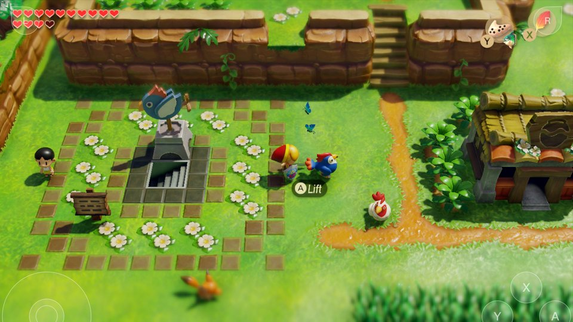
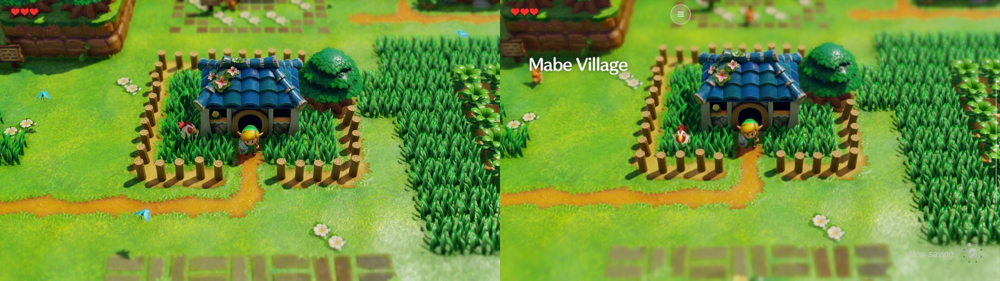

# The Legend of Zelda: Link's Awakening (`01006BB00C6F0000`)

Update 1.1.0 (v131072) over the base game, SDK 8.2.0. Grezzo's engine on NintendoWare (G3d / Ui2d / Vfx / Atk / Font), on NVN (API 53). Modules `main`, `subsdk0` (GLSLC, NVN's runtime shader compiler), `subsdk1` (NintendoSDK_movie) and `sdk`; Captain Toad: Treasure Tracker 1.4.2 runs the same `sdk` build ([01009BF0072D4000](../01009BF0072D4000/README.md)). Plays on the iPhone; gameplay at 60 fps as on the Switch, event cutscenes at 30 by the game's own choice. The README lists its IPA at about 6 GB.

## What it needs

| Setting | Where | Why |
|---|---|---|
| Physics completion task `release` → `ret` | [`patches.py`](patches.py) `CUTS`, `main` `909e904a…` at `main+0x10cd070` | a late destructor wiped the rebuilt task and crashed the physics workers; see [Physics](#physics) |
| Float vertex inputs 1–5 for `147c829e79fb322f`, `03c43da3e3f46da8`, `079700f3577e311f`, `15c02683a10f8e9d`, `2344874045b1e758` | [`shader_facts_manual.tsv`](shader_facts_manual.tsv) | the integer-input guess declared them `uint4` while the game feeds 16-bit or 8-bit normalized formats; see [Rendering](#rendering) |
| 4 GB layout: `mem_reserve 0x100000000`, `mem_alias 0x10000000`, `mem_stack 0x10000000`, `app_pool 0xCD500000` | [`game.tsv`](game.tsv) | no system resource in the NPDM: the game uses `SetHeapSize`. 13 Sentinels' partition (256 MB in front + 256 MB alias + 256 MB stack + 3.25 GB heap), "until measured" |
| `depth_mode zero` | `game.tsv` | the game sets the near = 0 depth mode, so the pipeline bases made before it runs (the NSP script's Mac prebuild, and a [pipeline archive made offline](../../../docs/development.md#the-pipeline-archive-made-offline) for the iPhone when one is built with `DM_PSO_GPUS`) take its vertex shaders' `main0_z` entries (the host itself follows the mode the game sets) |

`dm/tools/sdk_patches.py`'s SDK-wide rules cut its `sdk` build (`3ae34e68…`): the node area and 2 MB alignment of large regions. No `pad_layout`: the virtual gamepad starts in the 2D layout.

## Rendering

Game-specific findings; the general host changes they led to are listed under [Found on this game](#found-on-this-game).

- **Current: lower-left window origin.** It never calls `nvnDeviceSetWindowOriginMode`, so it keeps NVN's default lower-left (OpenGL) origin, where NDC y = −1 lands on a render target's first memory row; the six games before it all switched to upper-left. Read as upper-left, every texture the game renders and samples came out flipped and cancelled out, but text it renders into textures for the title and the menus came out upside down, and it copies the frame with `MIRROR_Y`. The host flips the direction inside the viewport (negative viewport height), reverses the front-face winding, and flips the window image at present and in raw screenshots (`g_origin_ll` in `nvn_mtl.m`).
- **Current: depth mode near = 0.** Every vertex library has a GL entry point and a near = 0 one (`main0_z`), picked from the mode the game set. **Resolved: outdoors the whole screen was blurred (Mac and iPhone).** The depth-of-field composite (`52fcbb4ca2a78907`, `postprocess.bfsha`) blends the sharp frame with two blurred levels by a blur amount computed from the half-size depth copy: `pow(clamp((c5[2].y / (depth + c5[2].x) − c5[3].x) · c5[3].y), c5[3].z)` above a screen line, by screen position below it. With every vertex shader translated for GL, all depths sat in 0.5..1 and everything was out of focus. Found with a save from the iPhone (Mabe Village outside the house), `DM_NVN_PASSDUMP` / `DM_NVN_TEXDUMP` of that frame, and LASRecomp, which rewrites z only for the GL mode.
- **Resolved: outdoors was dim and nothing cast a sun shadow (Mac and iPhone).** The sun's shadow map (2048×2048, 32-bit float depth) was correct, but every lookup failed. The surface shaders compute the lookup from a world position the vertex shader passes in `locn24`, divided by its w; the vertex shader writes only x, y and z. The translation started that output at 0 instead of the hardware's (0, 0, 0, 1), so w was 0 and every compare value infinite. Found with `DM_NVN_TEXRAW` on the shadow map, the light matrices from `DM_NVN_CBDUMP`, and a hand-edited surface shader that wrote the compare value and the stored depth as its colour. Every vertex output now starts at (0, 0, 0, 1) (`vs_init`); 12,281 of the game's 18,410 vertex outputs never write w. Compared with forcing the compare to pass: the same brightness, plus shadows from the fences, the house and the trees.
- **Resolved: flickering hard-edged white tiles on the step of Marin and Tarin's doorway (Mac and iPhone).** The room shaders use tiled forward lighting: the fragment position picks a 64×64-pixel tile (`trunc(y / 64) × ceil(width / 64) + trunc(x / 64)`), whose light count and indices come from two storage buffers a compute shader (`light_culling_compute.bfsha`, one thread per workgroup, one workgroup per tile) fills every frame. The culling shader computes its tile index as workgroup y × `c0[0x200]` + workgroup x, reading the dispatch's workgroup count from the driver segment `c0`, which the host passed as zeros (`dmsh_build.py`'s `drv_reads` matches only fragment-shader names). Every row's workgroups wrote row 0's entries, the last writer won (a different one each frame), and the bottom tile row, where the step is, got other rows' lights. A dump of the tile lists showed only the first of 17 rows filled. A declared driver-segment binding now counts as read (`nvn_refl.m`), and compute `c0` carries the dispatch size at 0x200, the uniform buffer table at 0x210 + 16 r and the storage buffer table at 0x310 (`encode_args_`). The doorway now shows the game's soft light from outside.
- **Resolved: missing palm tree and flowers** in Marin and Tarin's house (the pipeline `147c829e79fb322f` + `0ebba5ff6a44aa52`, `shadowmap_pbr.bfsha` variant 641, failed to build). Inputs 1–5 only move bits (in a loop: x bit-cast to an integer, y copied as a float), so the translation declared them `uint4`, and the game feeds them 16-bit normalized formats (RG16 / RG16_SNORM), which Metal will not pair with an integer input. These are the foliage's shadow-map and depth pre-pass draws; the main pass shades with depth test EQUAL, so without the pre-pass the plants never appeared. Declared float, the bits match the hardware's. Four outdoor shaders with the same loop failed the same way on the iPhone in Mabe Village (Half2, RG8 / RG16 normalized) and are listed too; input 7, a bone index used as an integer, stays `uint`. The guess is not wrong in general (1,437 of the game's vertex shaders have integer-typed inputs, many of them bone indices), so overrides are added only for shaders seen failing with float formats (`failed to create render pipeline … Cannot convert attribute …`). The table is on the chain, so it changes only this profile's chain version.
- **Resolved: no ambient occlusion.** The occlusion pass (`aa05724ffa62cb82`, a 480×270 R8 target cleared to 1.0) only writes where stencil bit 1 of the quarter-size depth-stencil copy is clear; the copy left the stencil undefined (new depth-stencil textures are not zero-filled), so on the Mac the mask kept 1.0 everywhere. The copy now carries the stencil.
- **Resolved: in handheld mode the picture filled only the bottom-left two thirds of the screen (iPhone).** The game keeps its 1920x1080 window textures in handheld mode, draws 1280x720 into them and crops through `vi::SetLayerCrop` (`0,0 1280x720`), never `nvnWindowSetCrop`; the NVN present read only the window's crop and showed the whole texture, the picture in its lower-left corner by the lower-left origin. It now shows the layer crop when the window sets none ([The NVN present crops by the vi layer crop](../../../docs/reference/rendering.md#the-nvn-present-crops-by-the-vi-layer-crop)). Checked on an iPhone 15 Pro (iOS 26.5.2), handheld, about 11 minutes in Mabe Village: the picture fills the screen's height at 60 fps.
- **Copies a blit cannot do** (`copy_t2t_draw`): RG11B10F → RGBA16F every frame, half-size depth-stencil copies (depth and stencil written from a fragment shader, stencil through `[[stencil]]` export from an `X32_Stencil8` view), and a scaled `MIRROR_Y` copy of the frame to 1280×720 RGBA8. Each is one render pass per layer.
- Uniform updates inside a pass no longer end it: about 15% less attachment traffic on the Mac.

## Audio and movies

- **Resolved: no music and no sound effects, only the movies' sound** (the log repeated `audren: first-frame commands …` every frame and never printed `DeviceSink inputs`). SDK 8 numbers the DSP commands differently: its command list goes 4×6, 7×24, 11×2, 16×1, 21×1 where SDK 20's goes 7×6, 11×24, 15×2, 20×1, 25×1, and the output command (DeviceSink, the same 0x148-byte layout with device name `MainAudioOut`, six inputs) is 0x10, not SDK 16's 0x13. When the expected ID is missing from the first full command list, `capture` in `hle_audren.c` takes the one 0x148-byte command with 1 to 6 inputs as the sink and logs the ID it adopted.
- **Resolved: an abort with Result 0x499 in `audio::GetAudioRendererWorkBufferSize`.** SDK 8's `AudioRendererParameter` is one word longer than SDK 16's (its revision at +0x38); the host copied only 0x38 bytes before switching it to CPU rendering, so `CheckValidRevision` read garbage. It copies 0x40 now.
- **Movies:** VP9 with a 5.1 Vorbis sound track (decoder type 5, output format 1, PCM16). The host decodes the sound with stb_vorbis, which needed a local fix for type-2 residues with more than two channels ([README](../../third_party/stb_vorbis/README.md)). **Resolved:** before it the opening and title movies sounded distorted and gurgling, with pops.

## Physics

- **Resolved: the physics workers crashed when a conversation or cutscene began** (`pc=main+0x10ccf28`, `lr=main+0x13c236c`; on the iPhone and in 2 of 5 Mac runs, in every Mac run under CPU load). The physics step (`main+0x15730`, main thread) rebuilds each world's PhysX completion task in place (a `PxLightCpuTask` at world+0xc8) before every `simulate`. A worker runs it (`main+0x10ccf80`: `fetchResults`, world+0x1d8 done = 1, notify, unlock) and then calls its `release` (`main+0x10cd070`), which calls the task's own destructor (vtable back to the `PxLightCpuTask` base, `mTm = 0`, `main+0x10cced0`). At 30 fps the game steps physics twice per frame (step, wait, step, wait); the unlock hands the world's mutex to the woken main thread, and when the worker is descheduled there the main thread's next step rebuilds the task before the late destructor runs, which then wipes the new one. The next simulation's `NpSceneCompletion::release` reads `mTm = 0`.
- **Current:** the release becomes a plain `ret`: the destructor only resets the vtable and `mTm` (no resources), the step rebuilds every field, and this release is used by this one vtable (`main+0x1c51308` slot 7) only.
- How it was found: 12 busy shell loops beside a scripted Mac run made the crash happen in every run (and the frame rate switch between 60 and 30 as on the phone), and observation gates (`OBS`) on the functions involved gave the order of events ([05, Racy crashes](../../../docs/agents/05-debugging.md#racy-crashes-load-trace-gates)).
- **Confirmed, 2026-10-26:** the recorded crash has priority-44 physics workers on cores 1 / 2 (masks 0x2 / 0x4) and a priority-44 main thread with mask 0x7. Their overlap is legal; no same-core priority handoff can protect the task. A controlled replay of the original constructor stores (`main+0x157a4` and `0x157dc`), relocated destructor vtable, release and `removeReference` reproduces the exact null load at `main+0x10ccf28` when the prior release follows reconstruction. Release-before-rebuild passes, as does the late release with the registered cut. This confirms a guest lifetime race; the earlier claim about nanosecond Switch timing was not measured and supplies no synchronization guarantee. The cut remains build-gated and justified. See [the replay command](../../../docs/agents/05-debugging.md#threading-cut-regressions) and [the lifetime contract](../../../docs/reference/threads.md#late-physx-task-destructor-after-the-unlock).

## Services and SDK 8

- **Resolved: an abort in `os::WaitSystemEvent` under `oe::PopNotificationMessage`**: the host's `oe::Initialize` now creates the notification event on its queue.
- **Resolved: SIGSEGV in `vi::SetLayerCrop`**: `SetLayerCrop` only records the crop for the present ([Rendering](#rendering)); `DestroyLayer`, `CloseDisplay` and `vi::Finalize` are host no-ops.
- **Resolved: the game never read the controller** (the title's "Press L+R" saw no press; no `GetNpadState` call): it waits for the event bound by `hid::BindNpadStyleSetUpdateEvent`, which the host now signals when bound for a connected controller and when a player's controller connects or goes away.
- `nvnWindowGetPresentInterval` and `nvnCommandBufferSetCopyImageStride` (the layer stride of texture ↔ buffer copies) implemented.
- Shared fonts: SDK 8, so the address is the plain TTF. Focus handling mode 2 (focus notifications are sent).
- Rewriter: offset jump tables in its GLSLC and movie `subsdk`s with the bounds check on another register (the index in `w0`, a copy, or a masked copy), which `jump_offsets` now follows.

## Files and shaders

- RomFS: bfres models and maps (`region_common/map`, `region_common/actor`), shaders in `region_common/shader/*.bfsha` (BNSH), particle effects in `region_common/effect/*.ptcl`, layouts in `*/ui/*.arc` (SARC).
- 9,698 shaders from the bfsha archives, effects and layouts.
- **GLSLC.** `subsdk0` is NVN's runtime GLSL compiler and `main` imports `glslcCompile*`; `game.tsv` says the `*_uber.bfsha` are compiled at run time through it, but up to the house, the beach and the menus every shader the game loaded was in the offline tables.

## Mac routes

- The title wants L+R: `DM_KEYS="f6000:L+R~0.4,f6300:A,f6500:A,f6700:Down,f6800:A"` reaches a new file's name entry (a fresh save directory via `SV=`).
- Racy crashes: run 12 busy loops beside the route (`for i in $(seq 12); do (while :; do :; done) & done`).

## Found on this game

General host changes first needed here; each applies to every game:

- **Lower-left window origin** (`g_origin_ll`), **copies drawn as passes** (`copy_t2t_draw`), **compute `c0` with the dispatch size** (`encode_args_`, `nvn_refl.m`), **stencil in depth-stencil copies**: [Lower-left window origin](../../../docs/reference/rendering.md#lower-left-window-origin), [Copies a blit cannot do, drawn](../../../docs/reference/rendering.md#copies-a-blit-cannot-do-drawn), [Compute `c0`: dispatch size and uniform buffer table](../../../docs/reference/shaders.md#compute-c0-dispatch-size-and-uniform-buffer-table), [Depth-stencil copies carry the stencil](../../../docs/reference/rendering.md#depth-stencil-copies-carry-the-stencil).
- **Per-depth-mode vertex entry points** (`vs_depth`, `main0_z`, `mtl_set_depth_zero`): [04, section 5](../../../docs/agents/04-graphics.md#5-depth-convention).
- **The NVN present crops by the vi layer crop** (`present_crop` in `hle_nvn.c`): [The NVN present crops by the vi layer crop](../../../docs/reference/rendering.md#the-nvn-present-crops-by-the-vi-layer-crop).
- **Vertex outputs start at (0, 0, 0, 1)** (`vs_init`): [Unwritten components of a written output start as (0, 0, 0, 1)](../../../docs/reference/shaders.md#unwritten-components-of-a-written-output-start-as-0-0-0-1).
- **The swapchain in the window texture's encoding (Android)** (`sc_encoding` in `front_android.c`): [An sRGB window texture shown through a UNORM swapchain is a gamma too dark](../../../docs/reference/rendering.md#an-srgb-window-texture-shown-through-a-unorm-swapchain-is-a-gamma-too-dark-android).
- **`shader_facts_manual.tsv`** for facts the machine code cannot tell: [dm/games/README.md](../README.md).
- **The DeviceSink found by its size** (`capture` in `hle_audren.c`), the SDK 8 parameter size, `oe` notifications, the npad style event: [SDK 8: command IDs numbered differently](../../../docs/reference/audio.md#sdk-8-command-ids-numbered-differently), [SDK 8's longer `AudioRendererParameter`](../../../docs/reference/audio.md#sdk-8s-longer-audiorendererparameter), [The oe notification event and its queue](../../../docs/reference/threads.md#the-oe-notification-event-and-its-queue), [Npad style set update event](../../../docs/reference/services.md#npad-style-set-update-event).
- **Jump tables checked on another register** (`jump_offsets`): [Offset jump tables with the bounds check on another register](../../../docs/reference/rewriter.md#offset-jump-tables-with-the-bounds-check-on-another-register).
- **Racy crashes under CPU load and observation gates**: [05, Racy crashes](../../../docs/agents/05-debugging.md#racy-crashes-load-trace-gates).
- **Saves from before backslash paths** (it names its files `save:\savedata0.bin`): [Saves named before backslash paths](../../../docs/reference/services.md#saves-named-before-backslash-paths).

## Open

- **`SR_Y_DIRECTION`.** 2,487 of its pixel shaders read the window's Y-direction system register, which is −1 under a lower-left origin. The Ryujinx recompiler answers a constant +1 (a TODO in `InstEmitMove.cs`; LASRecomp answers −1). In the room shader the value only scales a depth slope under `abs()`; other shaders may use its sign (`dFdy`-based effects). Answering it per profile means a translator change, i.e. every game's chain.
- **Two pixel shaders do not translate** (`9d8f6b8543355374`, `9338e3f1b597fe7c`: variants 0 and 1 of one program in `postprocess.bfsha` @0x252000; SPIRV-Cross throws on a null pointer). No run so far has loaded either.
- development.md calls SDK 8.2.0 "the oldest so far"; Mario Kart 8 Deluxe (SDK 4.4.0) is older now.
- `game.tsv` still says "In bring-up" and its memory values "until measured".

## Android

- **Resolved: a crash at boot on every launch of a Retroid Pocket 5**, now and then on a OnePlus Pad 3, never on an Ayn Odin 2: `CRASH sig=11 pc=main+0x1c180 lr=main+0x1bec8` on the main thread about 0.4 s in. The camera base constructor (`main+0x1bdb0`, reached for `MainCamera_1P` through `main+0xb5c50`) keeps the 16-bit index its parameters carry at `this+0xa0` and reads byte 0x49 of that entry of a 0x58-byte table at `main+0x1bcc898`. The function that builds the main camera's parameters (`main+0xbdaa0`) sets the index to 0xFFFF (`main+0xbdb68`) and nothing sets it before the constructor runs, so every boot reads `main+0x214c889`, 5.5 MB past main's end. A Switch maps the modules back to back, so there that is subsdk0's code (0x472889 into its text) and the read is harmless: the byte, 3, becomes what the camera's first virtual method returns (`main+0x1da40`, its only reader); the host mapped each module where `mmap` put it, and on Android the address was whatever happened to be mapped there, on the RP5 the hole main's freed file buffer had left. Not a race in the game: the crash came and went with what other mappings filled that hole by then. The modules are now mapped back to back ([Modules back to back, as Horizon maps them](../../../docs/reference/memory.md#modules-back-to-back-as-horizon-maps-them-android)); Mapped back to back with their patch areas, the read lands 0x438889 into subsdk0, which holds a 3 as well. `DM_MODULE_PACK=0` maps them as before. On the RP5 (2026-11-10), 0 of 11 boots crashed and the opening movie played at 57.4–58.9 fps (frame p50 16.67 ms, GPU 5.6–6.4 ms); on the same build with `DM_MODULE_PACK=0` 6 of 6 crashed, each at `main+0x214c889`.
- **Current: 30 fps in the overworld on the Retroid Pocket 5** (Ancient Ruins: 34.7–36.0 fps, frame p50 33 ms, picture right; the opening movie at 58 fps). Frames there need two vsyncs even at present interval 1, so the game's frame-skip logic (`main+0xca44`–`0xcb24`: the vsyncs the last frame took, less one when its CPU and GPU times are under its thresholds) switches between intervals 1 and 2 about 350 times a run. Per frame: the game's CPU 5.3 ms, the replay's recording of about 616 draws 9.7 ms, a 9.0 ms `nvnSyncWait` on the GPU, GPU 12.9 ms at the device's 490 MHz floor ([baselines, problem 12](../../android/baselines.md)).

- **By hand from a new game, OnePlus Pad 3, 2026-11-11.** Snapdragon 8 Elite, Adreno 830 with Qualcomm's driver (0x8032004a), Android 16. LA's host was built from `main` `1fdb7d00` and installed as an APK only, beside game files packed earlier with the same rewriter. Input came through `DM_CTL`, saves went to a `DM_SAVE` folder of their own, and there was an audio dump. Four launches, about 35 minutes.
  - **The route:**
    - the opening movie (A skips it on later starts), the title's L+R, File 1, Normal, the name "Link";
    - Marin's house: Marin's and Tarin's dialogue, and the shield;
    - Mabe Village (the telephone booth, Grandma Ulrira's house, the library, BowWow), the map (Minus), and the walled fields south of the village with their Octoroks;
    - Toronbo Shores.
  - **Where it stopped:** on the beach the enemies killed Link three times. He had only the shield, and adb steering from screenshots taken between moves couldn't fight in real time. "Retry" put him back at the beach's edge each time. Neither the sword nor the Mysterious Forest was reached.
  - **Saves:** autosaves while walking ("Now saving…"; `save commit` up to #18), then Game Over → Save and Quit → File 1 ("Game saved.", Toronbo Shores, dated 09:13 by the host's clock). After a cold start the file list showed it with the Mabe Village autosave, and Start put Link back on Toronbo Shores.
  - **Frame rate:** the log's 237 windows over the first launch (71,100 frames, about 20 minutes).
    - Marin's house and Mabe Village: 60 fps, window medians 16.6–16.8 ms.
    - The fields south of the village and Toronbo Shores: often the 30 fps interval, as in the Ancient Ruins (31 windows at 33.3 ms, 29 between). The game switches between one and two vsyncs, so the p95 is 33.6 ms throughout.
    - GPU 4.8–13.0 ms a frame, 10–13 ms where it drops to 30.
  - **Sound:** stereo. Two underruns in the first launch, otherwise none. The dump holds sound.
  - **Red line:** one, once per launch, around the first load outdoors: `storage buffer of shader d367b0db078dafba (c0 +0x3b0) is not a bound buffer: it reads 0`. That is `shape_anim_compute` (`region_common/shader/shape_anim_compute.bfsha`), reading compute storage slot 10, which has no buffer bound. Nothing in the picture showed it.
  - **Resolved: the picture on screen was a gamma too dark,** from the title on, until [#258](https://github.com/enjoyerofslop/droidplay-core/pull/258) ([An sRGB window texture shown through a UNORM swapchain is a gamma too dark](../../../docs/reference/rendering.md#an-srgb-window-texture-shown-through-a-unorm-swapchain-is-a-gamma-too-dark-android)). Mabe Village outside Marin's house looked like night beside the Mac's screenshot of the same spot (the screen's mean colour about 0.04–0.06).
    - Frame dumps looked right, because the presented texture's bytes are right: LA presents a 1920×1080 `RGBA8_SRGB` window.
    - The front end blits it into an `R8G8B8A8_UNORM` swapchain, and a blit decodes sRGB to linear without encoding again, so the screen showed linear values.
    - #258 makes the swapchain sRGB while the frame is. With it, Mabe Village is in daylight: mean colour 0.16, 0.24, 0.13 with the change on its branch, and 0.15, 0.24, 0.13 on `main` `205aef53` (q184).
    - The cause is in the front end, so every Android device showed LA too dark. Where the notes above call the Ancient Ruins' picture right, that holds for the frame itself, as dumps show it, not for what the screen showed.
    - `DM_VK_UBWC=0` doesn't change it, and neither the slot-0 fill nor the duplicate-slot fix applies to LA here (0 passes each).
  - **Resolved: nothing cast a sun shadow outdoors,** with the swapchain fixed: Link, the flowers and the cucco, none of which the Mac draws without one. Mabe stayed dimmer than on the Mac: at Marin's door its mean colour was 0.17, 0.25, 0.13, against 0.42, 0.56, 0.21 in the Mac's screenshot of the same spot. That isn't another gamma error, which would make the blue 0.03, but the missing direct sunlight.
    - It was LA's resolved Mac fault again, where vertex outputs left unwritten started at w = 0 ([Unwritten components of a written output start as (0, 0, 0, 1)](../../../docs/reference/shaders.md#unwritten-components-of-a-written-output-start-as-0-0-0-1)): `vs_init` fixed it in the MSL only, and Android's SPIR-V left those components undefined.
    - [#340](https://github.com/enjoyerofslop/droidplay-core/pull/340) starts them at (0, 0, 0, 1) on Android too ([Unwritten components of a written output start as (0, 0, 0, 1) on Android too](../../../docs/reference/shaders.md#unwritten-components-of-a-written-output-start-as-0-0-0-1-on-android-too)). Retroid Pocket 5, the Ancient Ruins save, two runs each (q242): with `DM_SPV_VSINIT=0` nothing casts a shadow; with the fix every pillar, statue, Link and the ruins' wall does, 20.6 % of the screen is 20+ levels darker, and the game keeps its 30 fps interval (33.7 and 37.3 fps against 36.6 and 36.0). Mabe's brightness against the Mac's wasn't measured again.
    
- **The sword, OnePlus Pad 3, 2026-11-11.** LA's host from `main` `205aef53` (with #258), the same way as above, from that save. Two launches, about 25 minutes.
  - **The beach:** the save puts Link at the water's edge, right below a Spiked Beetle. Idle, or walking east, he lost all three hearts within seconds, three times: twice to that beetle, once to a second one near the outcrops. Their hits knock him back into the surf.
    - Holding the shield (R) as he appeared held the beetle off, and he walked east through the shallow surf.
    - A Sea Urchin in the gap between two outcrops was pushed aside with the shield (one heart lost touching it).
    - A retry respawned him beside that gap instead.
  - **The sword:** the Owl's scene, then "Take", "You found your sword!" and "You can swing it with B".
  - **Save:** from the System tab, into File 1 (Toronbo Shores, dated 10:57). After a cold start Start put Link back at the sword's spot with it in hand.
  - **Frame rate:** on the beach, 49 of 93 log windows at 60 fps and 43 at the 30 fps interval, GPU 4.6–13.3 ms.
  - **Sound:** 3 underruns.
  - **Red line:** the same one per launch.
  - **Not tried:** fighting with the sword, the walk back north, the Mysterious Forest.
- **By hand from a new game to the sword and its first fights, Retroid Pocket 5, 2026-11-12 (q269).** Snapdragon 865, Adreno 650 with Qualcomm's driver (0x802ea000), Android 13. LA's host from `main` `021fc6b6` (with #340), installed as an APK only, beside game files packed earlier. Input came through `DM_CTL` over adb, steered from screenshots between moves, and saves went to a `DM_SAVE` folder of their own. Two launches, about 28 minutes.
  - **The route:**
    - the attract scene and the opening movie, which a first start plays through (A skipped it on the second start), the title's L+R, File 1, Normal, the name "Link";
    - Marin's house: Marin's dialogue, then Tarin, who stops Link at the door and gives him the shield once he walks over and talks to him;
    - Mabe Village, west along the dirt path past BowWow and the library, then south through the three gaps in the field walls (an Octorok took half a heart) to Toronbo Shores.
  - **The beach:** three Game Overs before the sword. An Octorok on the upper beach, then the Spiked Beetle and a Leever on the lower one, wore Link down between one screenshot and the next.
    - Retry put him back with three hearts at the beach's edge, the third time beside the Spiked Beetle.
    - With the shield raised as he appeared (`R+LRight` in `DM_CTL`: the button and the stick together), he walked east through the surf, pushed the Sea Urchin out of the gap between the two outcrops and reached the sword at the waterline.
  - **The sword:** the Owl's scene, then "Take" and "You found your sword!".
  - **Fights:**
    - before the save, the Sea Urchin, cut down with three strokes; then the Spiked Beetle and an Octorok together took his last hearts (the fourth Game Over);
    - after Continue, the urchin again (it dropped a green rupee) and two Sand Crabs, for half a heart.
    - Slow enemies can be fought this way. The Spiked Beetle, which needs a shield block before the sword can hurt it, wasn't beaten.
  - **Save:** Game Over → Save and Quit → File 1 ("Game saved.", Toronbo Shores, 10:58, 4 deaths). After a cold start the file list showed it beside the 10:55 autosave, and Start put Link back on the beach with the sword in hand.
  - **Frame rate:** the log's 300-frame windows, by where Link was.

    | Where | Windows | Median fps | GPU p50 |
    |---|---|---|---|
    | Marin's house | 31 | 59.3 | 9.3–13.2 ms |
    | Mabe Village | 14 | 31.8 | 10.2–12.9 ms |
    | The walled fields | 7 | 31.5 | 11.2–13.2 ms |
    | Toronbo Shores to the sword (the four Game Over screens run at 60) | 81 | 31.6 | 6.9–14.0 ms |
    | The beach after Continue | 17 | 30.9 | 11.5–13.3 ms |

    - Outdoors the Retroid Pocket 5 runs at the game's 30 fps interval, as at the Ancient Ruins (above). The Pad 3 kept Mabe Village at 60.
    - The same morning, LA's bench routes on this phone held the GPU at 490 MHz throughout (kgsl).
  - **Resident:** PSS 1.80 GB at the save in the first launch, 1.50 GB on the beach in the second.
  - **Sound:**
    - a 48 kHz stereo AAudio stream at clock rate 1.000;
    - 88 % of the first launch's 264,000 renderer frames not silent (the host's `audren` count);
    - 5 underruns in the first launch, 2 in the second.
    - Not listened to.
  - **Red line:** the same one per launch (`shape_anim_compute`'s unbound storage slot).
  - **No crash.**
  - **Against the Mac:** Link at Marin's door in Mabe Village, the Mac's screenshot (left, this repository's [picture](../../../docs/images/zelda-links-awakening.jpg)) and the Retroid Pocket 5's (right).
    - Mean colour over the house, fence and path: 0.402, 0.518, 0.215 on the Mac and 0.413, 0.529, 0.220 here, against 0.17, 0.25, 0.13 before #340.
    - The sun shadows of the fence posts, the cucco and Link are the same.
    - The phone's frame is a little softer, from the handheld 1280x720 picture shown full screen.

    

  - **Not tried:** the Mysterious Forest, and a fight with the Spiked Beetle.
